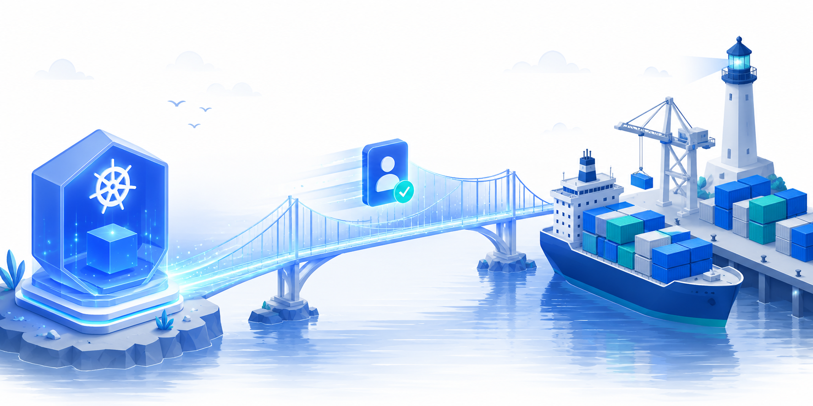
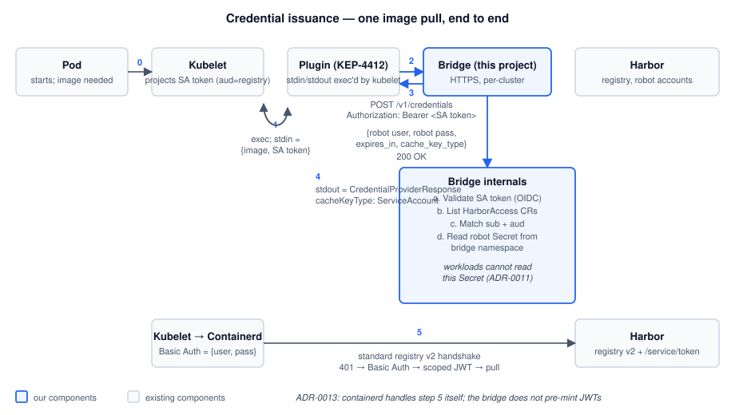

<p align="center">
  
</p>

# Harbor Workload Identity Bridge

Pods pull private images from Harbor with the Kubernetes ServiceAccount they
already run as. Workload namespaces need no `imagePullSecrets` and hold no
registry credentials.

<p align="center">
  <a href="LICENSE"></a>
  <a href="https://github.com/AetherizeGmbH/harbor-workload-identity-bridge/releases"></a>
  <a href="https://github.com/AetherizeGmbH/harbor-workload-identity-bridge/actions/workflows/test.yml"></a>
  
  <a href="https://github.com/goharbor/harbor/issues/17520"></a>
</p>

Status: alpha. The `v1alpha1` API and the chart values can still change.
Read [MIGRATION.md](MIGRATION.md) before you upgrade.

## Why

Without this project, every namespace that pulls from a private Harbor needs an
`imagePullSecret` with a long-lived robot password. Anyone who can start a pod
in that namespace can mount the Secret and read the password, and a rotation
has to touch every namespace.

Cloud registries avoid this with kubelet credential providers
([KEP-4412](https://github.com/kubernetes/enhancements/issues/4412)): kubelet
authenticates the pod with its ServiceAccount token and gets short-lived
credentials for the pull. Harbor does not support this yet
([goharbor/harbor#17520](https://github.com/goharbor/harbor/issues/17520)).
This project adds the missing part until Harbor does.

## How it works



1. You create a `HarborAccess` object in the bridge namespace. It names one
   ServiceAccount and the Harbor projects and actions that ServiceAccount gets.
2. The bridge creates a Harbor robot account for each `HarborAccess`, keeps
   the robot password in a Secret in its own namespace, and rotates the
   password every 24 hours.
3. When a pod pulls a matching image, kubelet runs the credential-provider
   plugin and gives it a token for the pod's ServiceAccount.
4. The plugin sends the token to the bridge. The bridge validates the token
   and returns the robot's username and password.
5. containerd does Harbor's normal token handshake with these credentials and
   pulls the image.

A change to a `HarborAccess` changes the robot's permissions in Harbor. When you
delete the `HarborAccess`, the bridge deletes the robot. Several clusters can
share one Harbor: each cluster runs its own bridge, and the cluster name in
every robot name (`bridge-<cluster>.<namespace>.<serviceaccount>`) keeps the
robots of different clusters apart
([ADR-0018](docs/adr/0018-dot-delimited-naming.md)).

The chart installs the bridge as a Deployment and the plugin as a DaemonSet
that configures kubelet on every node. [SECURITY.md](SECURITY.md) describes
what the design protects against and what it does not.

## Requirements

- Kubernetes 1.34 or later, Linux nodes (amd64 or arm64)
- Harbor 2.9 or later, with admin credentials (see
  [Harbor compatibility](#harbor-compatibility))
- cert-manager
- Helm 3.8 or later

## Quickstart

1. Create the namespace and a Secret with the Harbor admin credentials. The
   chart does not create this Secret, so the password stays out of your values
   files.

   ```bash
   kubectl create namespace harbor-bridge-system
   kubectl create secret generic harbor-admin -n harbor-bridge-system \
     --from-literal=username=admin \
     --from-literal=password='<harbor admin password>'
   ```

2. Install the chart. cert-manager must be installed in the cluster.

   ```bash
   helm install harbor-bridge \
     oci://ghcr.io/aetherizegmbh/charts/harbor-workload-identity-bridge \
     --version 0.18.0 \
     -n harbor-bridge-system \
     --set clusterName=prod-eu-west \
     --set harbor.url=https://harbor.example.com \
     --set harbor.adminCredsSecret.name=harbor-admin
   ```

   - The tokens kubelet sends to the bridge have the audience
     `harbor-bridge-<clusterName>`, here `harbor-bridge-prod-eu-west`. Every
     `HarborAccess` must name it. The cluster name in it keeps a token from
     one cluster from working on another cluster that uses the same Harbor.
     `plugin.audience` sets another value.
   - Kubelet calls the plugin for images from the host of `harbor.url`, here
     `harbor.example.com`. If your pods pull under another name, set
     `plugin.matchImages` to registry hosts (`harbor.example.com` or
     `host:port`). Kubelet does not support globs in the path:
     `harbor.example.com/*` never matches.
   - The bridge reads the cluster's ServiceAccount token issuer and signing
     keys from the Kubernetes API server, on kind and kubeadm as on GKE, EKS
     and AKS. `bridge.oidcIssuer` sets the issuer instead
     ([docs/platforms.md](docs/platforms.md#managed-clouds-what-to-expect)).
   - The chart creates a CA for the release with cert-manager. It signs the
     bridge's TLS certificate, which the plugin verifies on every node, and
     with `bridge.mTLS` the plugin's client certificate.
     `tls.issuerRef.name` names your own issuer instead.
   - The plugin DaemonSet configures kubelet on every node and restarts
     kubelet once per node when the configuration changes. Running containers
     keep running. [docs/operations.md](docs/operations.md) explains the
     install modes, and [docs/platforms.md](docs/platforms.md) lists what
     happens on kind, kubeadm, GKE, EKS, AKS, Talos, k3s and RKE2.

3. Create a `HarborAccess`. Its `audience` must be the audience from step 2.
   `helm install` prints it.

   ```bash
   kubectl apply -f - <<'YAML'
   apiVersion: harbor.aetherize.io/v1alpha1
   kind: HarborAccess
   metadata:
     name: flux-access
     namespace: harbor-bridge-system
   spec:
     serviceAccountRef:
       namespace: flux-system
       name: source-controller
     trustPolicy:
       audience: harbor-bridge-prod-eu-west
     permissions:
       - project: production
         action: pull
     tokenTTL: 1h0m0s
   YAML
   ```

After a few seconds Harbor has a robot
`bridge-prod-eu-west.flux-system.source-controller`, and pods that run as
`flux-system/source-controller` can pull from `harbor.example.com/production/`.

## Uninstalling

Delete all `HarborAccess` objects before you run `helm uninstall`. Each object
has a finalizer, and only a running bridge can remove it and delete the Harbor
robot. `helm uninstall` then has every node remove the plugin and its kubelet
configuration before it deletes the release (ADR-0039); in `none` mode the
nodes keep the plugin binary. [docs/operations.md](docs/operations.md#uninstalling)
says what to do when a node fails, and how to clean a node by hand.

## Documentation

| Document | Content |
| --- | --- |
| [docs/operations.md](docs/operations.md) | Node install modes, several installs per cluster, bootstrap ordering, complete uninstall |
| [docs/platforms.md](docs/platforms.md) | Behaviour and support per node platform |
| [docs/install-external-plugin.md](docs/install-external-plugin.md) | Nodes that get the plugin from somewhere else (Talos, baked images) |
| [SECURITY.md](SECURITY.md) | Security model, hardening, audit log, release verification, reporting a vulnerability |
| [MIGRATION.md](MIGRATION.md) | Upgrade notes per release |
| [HOW-TO-TEST.md](HOW-TO-TEST.md) | End-to-end tests on kind and GKE, running the bridge locally |
| [docs/adr/](docs/adr/README.md) | Architecture decision records |
| [docs/roadmap.md](docs/roadmap.md) | Status, next steps and open decisions |
| [CHANGELOG.md](CHANGELOG.md) | Release history |

## Harbor compatibility

The bridge uses only Harbor's robot account API (`/api/v2.0`). The
`harbor-compat` workflow runs the full end-to-end pull test against each
Harbor version below, weekly and on demand, and opens a pull request that
updates this table ([ADR-0020](docs/adr/0020-harbor-compatibility-matrix.md)). Versions between
two rows are not tested individually.

<!-- BEGIN HARBOR-COMPAT (generated by .github/workflows/harbor-compat.yml — do not edit by hand) -->

| Harbor | Chart | Tested | Last run (UTC) |
| --- | --- | --- | --- |
| 2.15.2 (ceiling) | 1.19.2 | ✅ | 2026-11-02 |
| 2.13.5 | 1.17.5 | ✅ | 2026-11-02 |
| 2.11.2 | 1.15.2 | ✅ | 2026-11-02 |
| 2.9.5 (floor) | 1.13.5 | ✅ | 2026-11-02 |

<!-- END HARBOR-COMPAT -->

## Support

The project is free to use under Apache 2.0. Aetherize offers a free one-hour
review of your registry access setup, and paid help with implementation,
migration and operation: [contact@aetherize.com](mailto:contact@aetherize.com).

## Contributing

Open an issue or a pull request for bugs and design questions. A significant
design change needs an [ADR](docs/adr/0001-record-architecture-decisions.md).

## License

Apache 2.0, see [LICENSE](LICENSE) and [NOTICE](NOTICE).
